# LiDRON Simulation

PX4, Gazebo and ROS 2 in Docker, flying our two drones as they are drawn in the CAD.

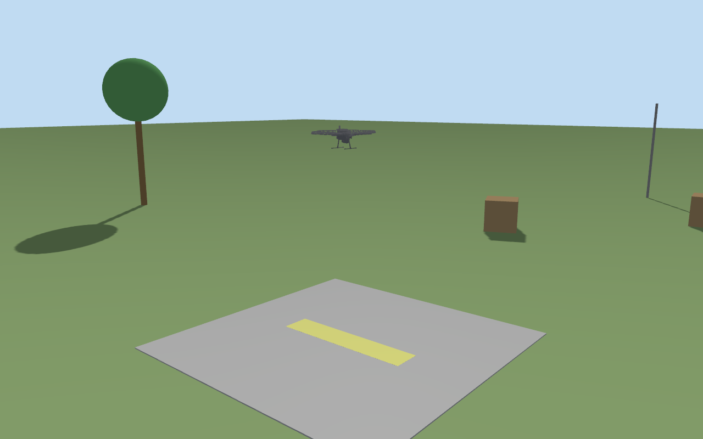

## Run it

1. Get the code and the settings file:

   ```bash
   git clone https://github.com/LiDRON7/Simulation.git
   cd Simulation
   cp .env.example .env
   ```

2. Open `.env` and set the lines for your machine:

   | Your machine | Set in `.env` |
   |---|---|
   | Linux desktop with an NVIDIA GPU | install `nvidia-container-toolkit`, add `-f docker-compose.gpu.yml` after the main file, then do the [window setup](#the-gazebo-window-linux-desktop) |
   | No desktop, or you are on ssh | `HEADLESS=1` |
   | Laptop with no GPU, or a Mac with Docker Desktop | `HEADLESS=1`, and `SENSORS=off` if it runs too slowly |

3. Start it. The first build takes about 20 minutes and 10 GB, because it compiles PX4.

   ```bash
   docker compose -f docker-compose.dev.yml up --build
   ```

4. In a second terminal, check that it flies:

   ```bash
   tools/hover_test.sh
   ```

   ```
   drone: huntsman. Waiting for PX4 (up to 2 minutes)...
   hover: Gazebo says 2.22 m up, PX4 says 2.25 m
   motors: control: [0.57446, 0.57393, 0.56995, 0.57843, 0.57188, 0.57650]
   landed and disarmed
   PASS
   ```

Stop it with `docker compose -f docker-compose.dev.yml down`.

## Pick the drone

Set `DRONE=huntsman` or `DRONE=widow` in `.env`, then restart.

| `huntsman` (default) | `widow` |
|---|---|
| 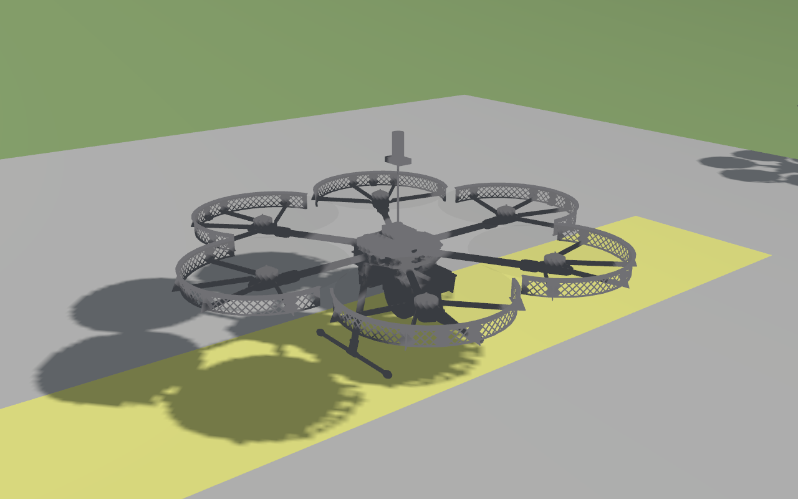 | 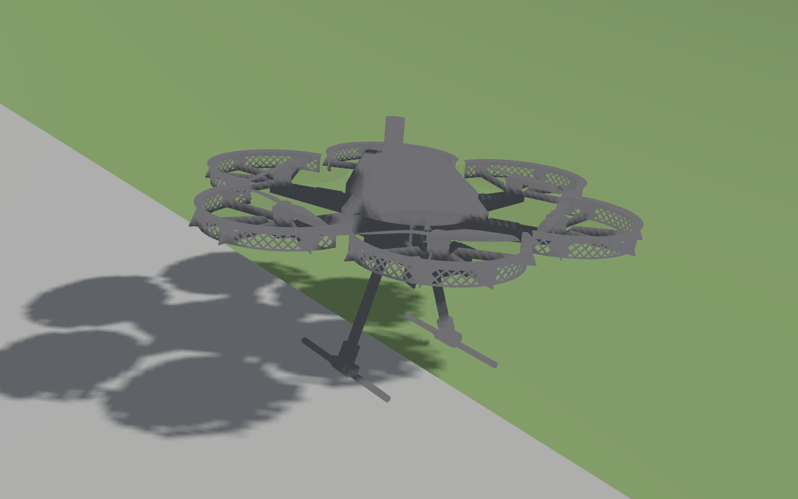 |
| Tarot 680 PRO, 4.26 kg | Storm Drone 6 V3, 1.88 kg |
| OAK-D Pro camera and a Velodyne Puck LITE on its side | OAK-D Pro camera, no LiDAR |

## Fly it by hand

PX4 takes commands through `docker exec`:

```bash
px4() { docker exec -w /px4/build/px4_sitl_default drone_px4 ./bin/px4-"$@"; }

px4 commander check      # Preflight check: OK
px4 commander takeoff    # climbs to 2.5 m and holds
px4 commander land
px4 listener vehicle_local_position -n 1
```

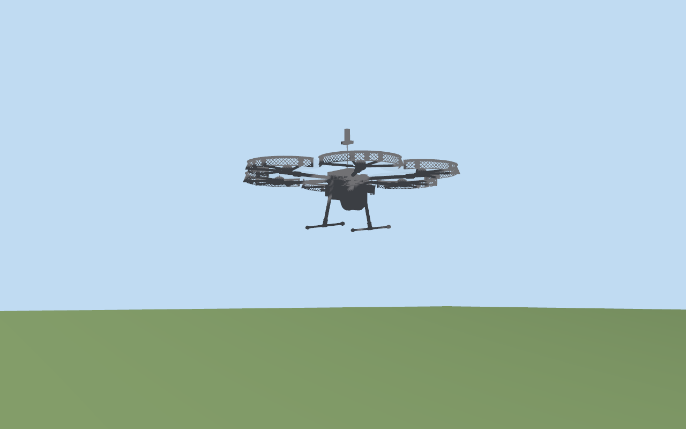

Where PX4 thinks it is, next to where Gazebo has it:

```
$ px4 listener vehicle_local_position -n 1
    x: -0.35275
    y: 0.09305
    z: -2.80928          (down is positive, so this is 2.8 m up)
$ docker exec drone_sim_dev gz model -m huntsman_0 -p
  - Pose [ XYZ (m) ] [ RPY (rad) ]:
    [0.000296 -0.107731 3.523510]
    [-0.004370 -0.000580 -0.010772]
```

The two heights do not agree exactly. In my runs they were between a few centimetres and 1.3 m apart, and the stock x500 shows it in this world too. I have not found the cause.

On Linux, QGroundControl on the same machine connects by itself (UDP 14550) and gives you the map and the takeoff button.

## What the drone sees

The camera, with the two front prop guards along the top edge:

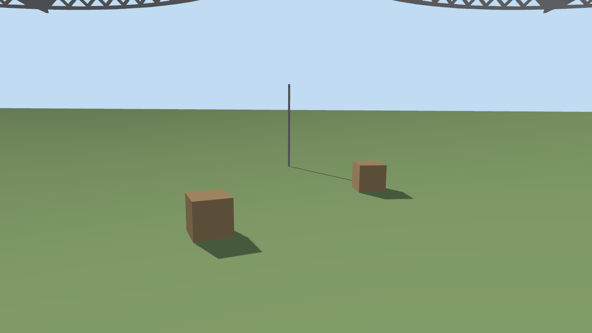

Its depth image. The guards are the yellow shapes 0.2 to 0.3 m away:

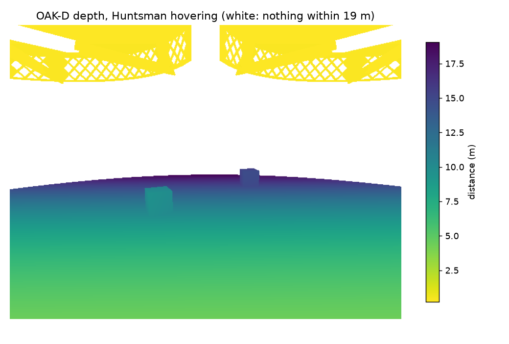

One scan from Huntsman's LiDAR at 3.5 m up. The ground comes out flat 3.5 m below, with the crates at 10 and 15 m and the pole at 20 m:

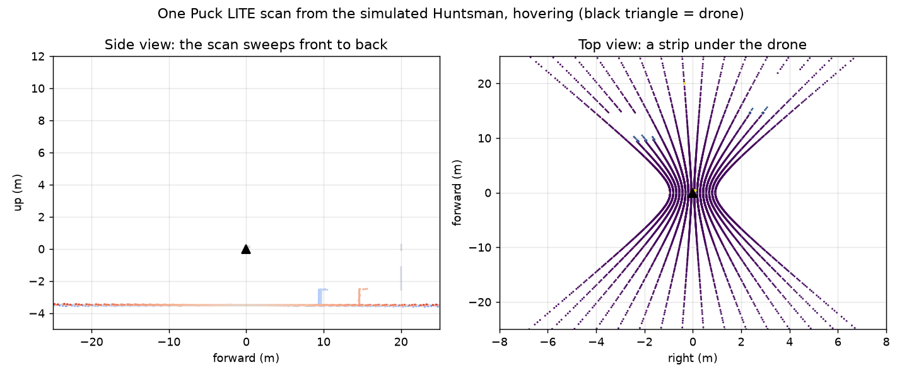

The LiDAR lies on its side, so it scans a band from front to back under the drone. About 40 % of its returns hit the drone itself. `Autonomous-Systems` turns the cloud with `lidar_mount_rpy_deg: [90, 135, 0]`, which is how the plot above was made, and its self-filter box drops every one of the drone's own returns in this scan.

The same data in ROS 2:

```bash
docker exec drone_ros bash -c "source /opt/ros/jazzy/setup.bash && ros2 topic list"
```

```
/clock
/gps
/imu
/lidar/points
/oakd/color/camera_info
/oakd/color/image
/oakd/depth/image
/oakd/depth/points
```

| Topic | Type | What |
|---|---|---|
| `/oakd/color/image` | `sensor_msgs/Image` | camera, 1280 x 720 |
| `/oakd/depth/image` | `sensor_msgs/Image` | depth in metres, 640 x 480, sees 0.2 to 19 m |
| `/oakd/depth/points` | `sensor_msgs/PointCloud2` | the depth image as points |
| `/lidar/points` | `sensor_msgs/PointCloud2` | 16 beams x 1800 points, in the LiDAR's own frame (Huntsman only) |
| `/imu` | `sensor_msgs/Imu` | 250 Hz |
| `/gps` | `sensor_msgs/NavSatFix` | the field sits at UPRM, 18.2110 N 67.1409 W |

With `SENSORS=off` the camera and LiDAR topics are listed but stay empty.

## Run the autonomy on it

With [Autonomous-Systems](https://github.com/LiDRON7/Autonomous-Systems) cloned next to this repo:

1. Start both, from the Autonomous-Systems folder. It reads this repo's `.env`, so the drone is the same.

   ```bash
   ./scripts/simulation.sh up
   ```

2. In a second terminal, open a shell in the autonomy container:

   ```bash
   docker exec -it lidron_autonomy bash
   source /autonomy/install/setup.bash
   ```

3. Check, set a destination 8 m north, and start:

   ```bash
   ros2 service call /autonomy/preflight_check std_srvs/srv/Trigger {}
   ros2 service call /autonomy/set_local_destination interfaces/srv/SetLocalDestination '{north: 8.0, east: 0.0, down: 0.0}'
   ros2 service call /autonomy/enable std_srvs/srv/SetBool '{data: true}'
   ```

4. Watch it: `ros2 topic echo /autonomy/state`

What that mission did with Huntsman, state next to Gazebo's position (east, north, up in metres):

```
PREFLIGHT       [0.40 0.29 0.23]
TAKEOFF         [0.58 0.25 1.93]
TAKEOFF         [0.55 0.23 3.75]
NAVIGATING      [0.64 2.06 3.89]
NAVIGATING      [0.49 7.41 3.91]
LANDING_CHECK   [0.48 8.36 3.77]
LANDING         [0.52 8.34 2.88]
LANDING         [0.46 8.16 0.21]
COMPLETE        [0.46 8.16 0.21]
```

Widow flew the same mission and landed at 7.74 m north. It has no LiDAR, so it skips the landing check.

Two things from these runs:

- PX4 was told 5 m and believed it was there. Gazebo had Huntsman at 3.7 m above the pad and Widow at 4.7 m. Do not trust simulated height to better than a metre yet.
- Widow sat on the ground for about ten minutes before PX4 disarmed it. Huntsman disarmed within seconds.

## Test every way a mission can end

`Autonomous-Systems/scripts/sim_scenarios.sh` flies the autonomy through this world and says PASS or FAIL for each
case, checking positions against Gazebo's own (not PX4's). Start the stack first (`./scripts/simulation.sh up`), then:

```bash
./scripts/sim_scenarios.sh             # all of them
./scripts/sim_scenarios.sh avoid abort # some
```

My run on 2026-11-15 on the final Milestone 3 code, Ubuntu + RTX 3060 Ti, both drones at the real 5 mph speed limit,
a fresh simulator for every scenario:

| Scenario | What it checks | Huntsman | Widow |
|---|---|---|---|
| `a_to_b` | flies 7 m and lands | 0.37 m from the point | 0.18 m |
| `avoid` | a tree in the way at 3 m | around it in 6 of 6 runs, 0.39 to 1.03 m clear | 4 of 4, 0.71 to 0.93 m clear |
| `abort` | `/autonomy/abort` mid-flight | PX4 lands where it is | same |
| `hold` | pause and resume | moved 0.17 m in 10 s, then landed 0.57 m from the point | 0.01 m, 0.33 m |
| `takeover` | the pilot switches PX4 to Hold | autonomy stands down, refuses abort and enable | same |
| `bad_landing` | sent onto a 1 m crate | LiDAR refuses it, lands 1.58 m from its centre | skipped: no LiDAR |
| `timeout` | mission timeout | lands where it is | same |
| `battery` | PX4 low battery failsafe | takes over in the air at 5 m, autonomy stands down | same |
| `perception_crash` | perception node killed | HOLD, then lands | same |
| `autonomy_crash` | mission node killed | PX4 lands on its own, within 3 m | within 2.4 to 3.7 m |

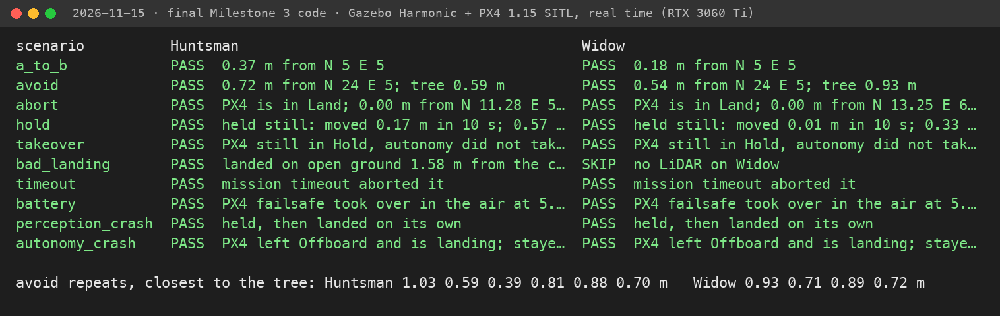

`popup` (a wall appears 2.5 m ahead mid-flight) isn't in the default list yet: the drone sees it but still hits it. That's
Autonomous-Systems #95.

## Record a scenario

`tools/record.sh` flies any of the scenarios above and turns it into videos you can watch or post on an issue. Every
video gets a minimap in the corner: the obstacle map (grey), the A* path the drone is following (blue), the start A,
the goal B, the drone and its trail, and the mission state.

1. Start nothing by hand. The script starts the simulator and the autonomy, flies, and shuts them down.
2. Pick the drone, the views and one or more scenarios:

   ```bash
   tools/record.sh huntsman chase,onboard,depth,lidar avoid
   tools/record.sh widow chase,tree takeover a_to_b     # both in one sim, one after the other
   ```

3. Wait for `videos in recordings/...`. That folder has one `.mp4` per view, `log.txt` with the PASS/FAIL lines,
   and `data/` with the raw recording.

| View | What you see |
| --- | --- |
| `chase` | a camera following behind the drone |
| `onboard` | what the drone's own camera sees |
| `pad`, `tree`, `crate`, `wide` | fixed cameras at those spots in the field |
| `depth` | the OAK-D depth image, coloured by distance, with the box the obstacle check looks in |
| `lidar` | what the landing check sees under the drone: ground in green, everything else in red, the footprint it judges, and its verdict (Huntsman only). Start here when a landing goes wrong |
| `lidar-chase`, `lidar-top`, `lidar-pad`, ... | the whole LiDAR cloud from that angle: ground grey, anything taller coloured by height (Huntsman only) |

| | |
| --- | --- |
| 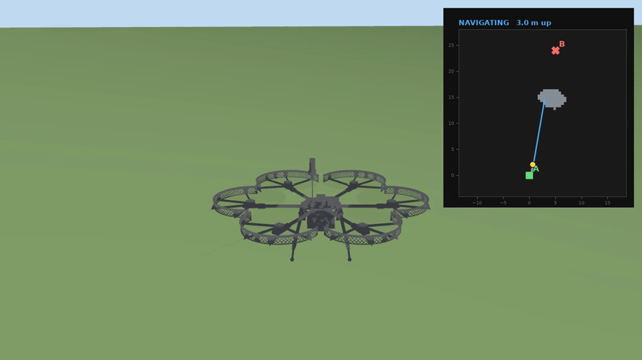 | `chase`: Huntsman flying around the tree. The minimap shows the tree in the obstacle map, the A* path in blue, the start A and the goal B. |
| 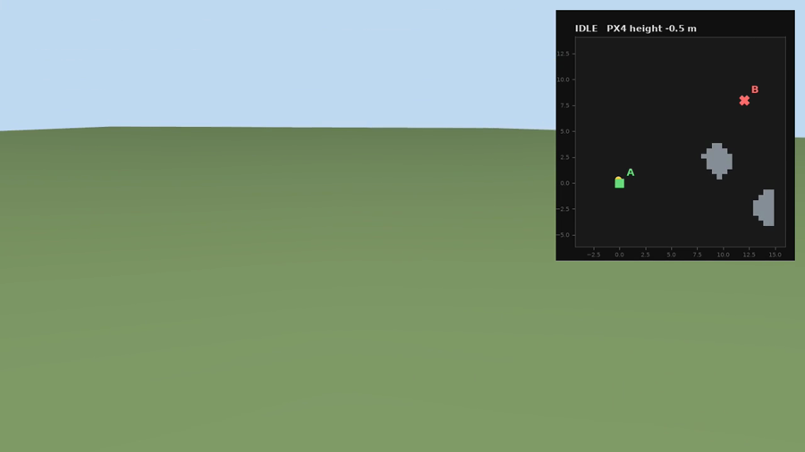 | `onboard`: Widow on the pad. The two crates are already in the map; the grass is not. |
| 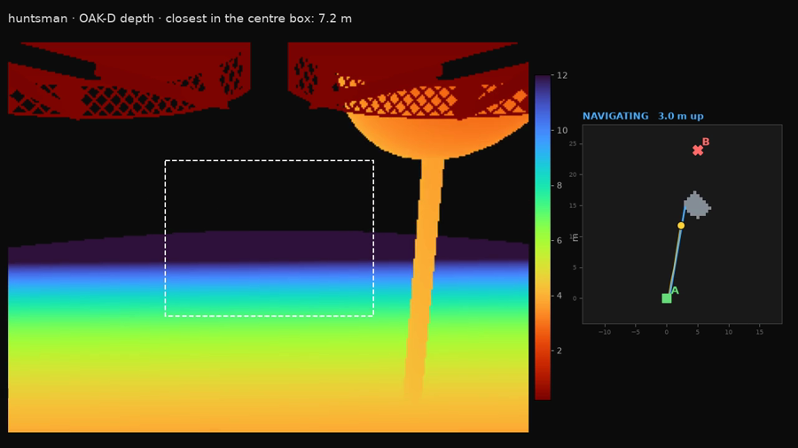 | `depth`: what the OAK-D measures, coloured by distance. The dashed box is where the obstacle check looks; Huntsman's own prop guards show at the top. |
| 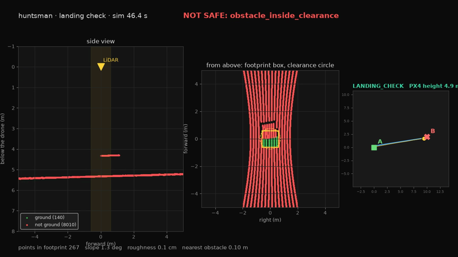 | `lidar`: Huntsman over the crate. The side view shows the lid 4.3 m down and the real ground a metre below it, so the check says NOT SAFE and it lands next to the crate. |
| 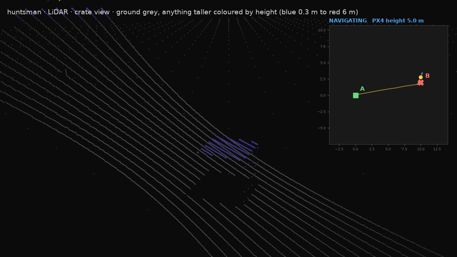 | `lidar-crate`: the whole LiDAR scan seen from the crate camera. The crate lid stands out in blue, with its shadow behind it. |

It needs Docker and ffmpeg. The depth, LiDAR and minimap drawings use [uv](https://docs.astral.sh/uv), which fetches
numpy and matplotlib by itself; without uv the script tells you the one command to run on a machine that has it.
It runs in real time only on Linux with an NVIDIA GPU. On a Mac it works, but the camera and LiDAR are drawn in
software (about 0.16x real time on my Mac with sensors on), so expect a one-minute scenario to take a good while. If you only have a Mac, ask for a run on the lab's GPU
machine instead.

## The Gazebo window (Linux desktop)

Without `HEADLESS=1`, Gazebo opens its window on your screen. Docker needs permission for that, once after every reboot:

```bash
xhost +local:docker
touch /tmp/.docker.xauth
xauth nlist $DISPLAY | sed -e 's/^..../ffff/' | xauth -f /tmp/.docker.xauth nmerge -
```

If `echo $DISPLAY` prints nothing, run `export DISPLAY=:0` first.

I did not rerun the window on this branch. Everything on this page was run with `HEADLESS=1`, and the pictures come from cameras placed in the simulated world.

## How fast it runs

On my Mac (Docker Desktop, no GPU):

| `.env` | Hover test | Speed |
|---|---|---|
| `HEADLESS=1`, `SENSORS=off` | passes for both drones | real time |
| `HEADLESS=1` (sensors on) | passes for Huntsman | slower than real time: LiDAR about 3 scans a second and depth about 7 frames, against 10 and 30 |

On my Ubuntu PC (RTX 3060 Ti) with `-f docker-compose.gpu.yml`, sensors on: real time, both drones.
`GPU_VENDOR` alone does nothing on its own: the container also needs the GPU, which is what the extra file gives it.

## After a CAD change

`models/` and `config/airframes/` are generated. Do not edit them.

1. Rerun the full-drone script in Fusion ([Drone-Construction](https://github.com/LiDRON7/Drone-Construction), `3D Models/Fusion Scripts`). It writes `<Drone>/Full Drone/<drone>-checks.json`.
2. Rebuild the models here, with Drone-Construction cloned next to this repo:

   ```bash
   python3 tools/cad_to_sdf.py
   ```

   ```
   widow: 1878 g, inertia [0.0244, 0.0238, 0.0303] kg m2, hover throttle 0.57, thrust/weight 2.61 (EST), camera at [0.083, 0.001, -0.048], no lidar, skids 0.224 m under the centre of mass
   huntsman: 4256 g, inertia [0.1023, 0.1071, 0.1872] kg m2, hover throttle 0.56, thrust/weight 2.67 (EST), camera at [0.134, 0.001, -0.037], lidar at [0.043, -0.001, -0.071], skids 0.211 m under the centre of mass
   ```

3. Run `tools/hover_test.sh` for each drone.

To also rebuild the look, add `--mesh` (needs `pip install numpy scipy fast-simplification`). Huntsman's full-drone STL is too big for git, so export it from Fusion and pass `--stl huntsman=<file>`.

## What is real and what is a guess

| | Where it comes from |
|---|---|
| Weight, centre of mass, motor and sensor positions, skids, the look | the CAD |
| Moments of inertia | estimated from the weight table, good to about 20 % |
| Motor thrust and top speed | a guess. Nobody has put a motor on a thrust stand yet |

Hover throttle, flight time and top speed all depend on that guess, so do not read them off the simulator.

## When it breaks

| What you see | Do this |
|---|---|
| `hover_test.sh` says PX4 never passed preflight | `docker logs drone_px4`. PX4 starts 20 s after Gazebo; on a slow machine give it a minute and rerun |
| `Gazebo has no model called ..._0` | `DRONE` in `.env` is not the one that is running. Restart the stack |
| No window, or `cannot open display` | set `HEADLESS=1`, or redo the window setup |
| Everything crawls | set `SENSORS=off` |
| A change to `.env` does nothing | `down`, then `up` again |

## What is in here

```
docker-compose.dev.yml   three containers: Gazebo (drone_sim_dev), PX4 (drone_px4), ROS 2 bridge (drone_ros)
docker/                  the image: ROS 2 Jazzy, Gazebo Harmonic, PX4 v1.15.0
models/                  widow and huntsman, generated from the CAD
config/airframes/        the PX4 airframe for each drone, generated
config/                  which Gazebo topics go to ROS 2
worlds/outdoor_field.sdf the field: landing pad, two crates, a pole, two trees, light wind
tools/cad_to_sdf.py      CAD to models
tools/hover_test.sh      takeoff, hover, land, PASS or FAIL
```
